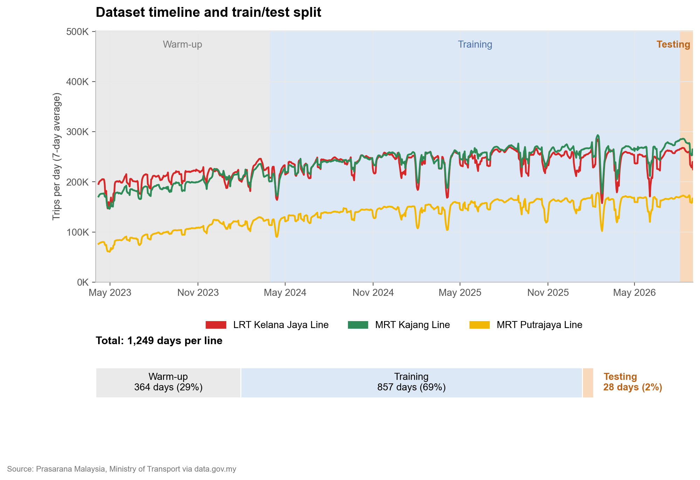
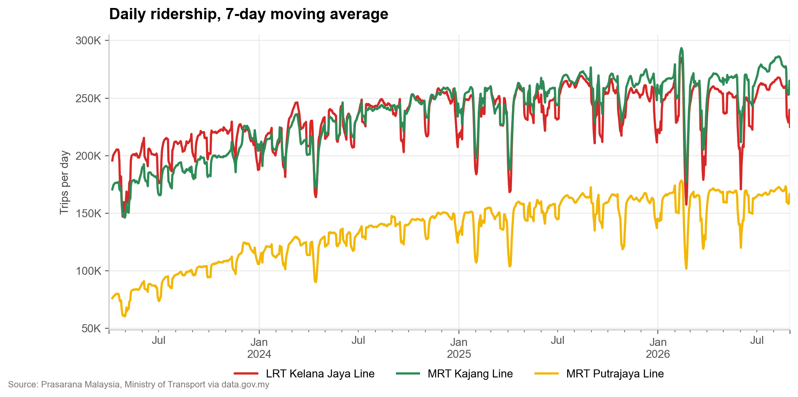
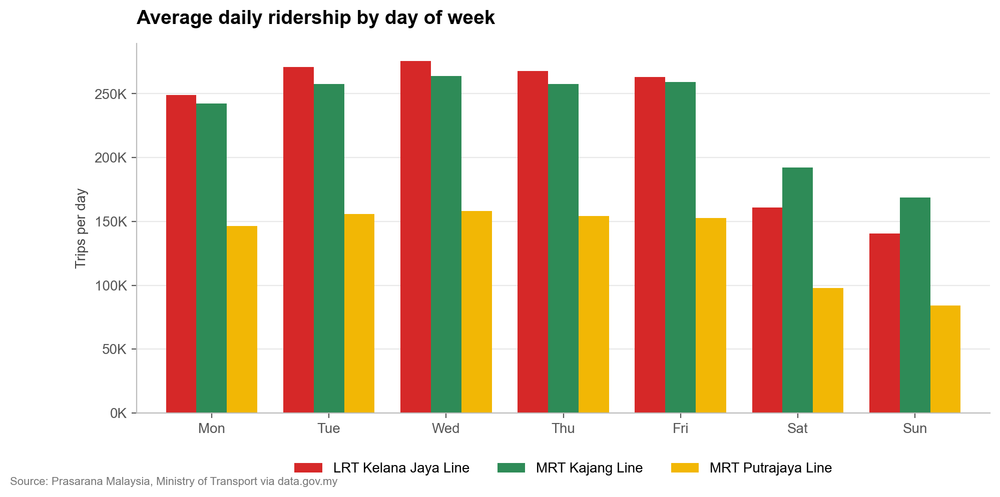
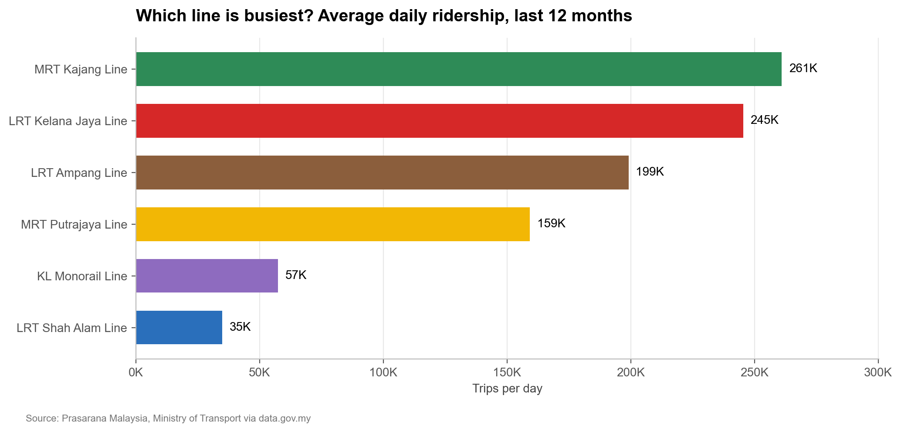
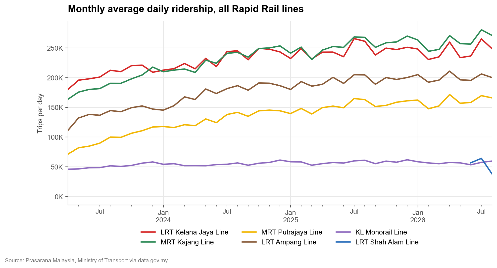
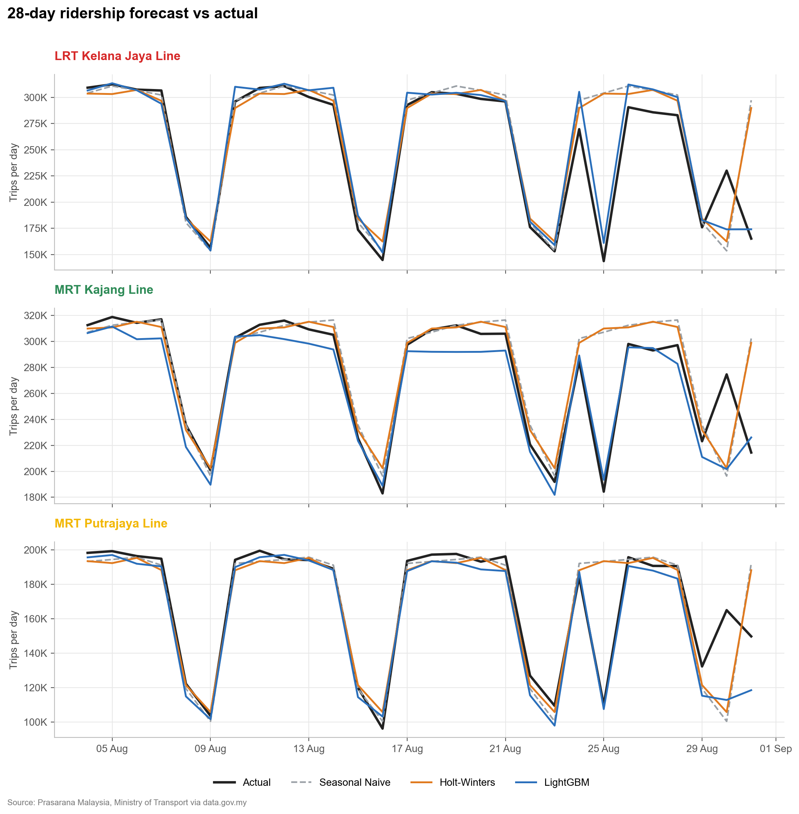
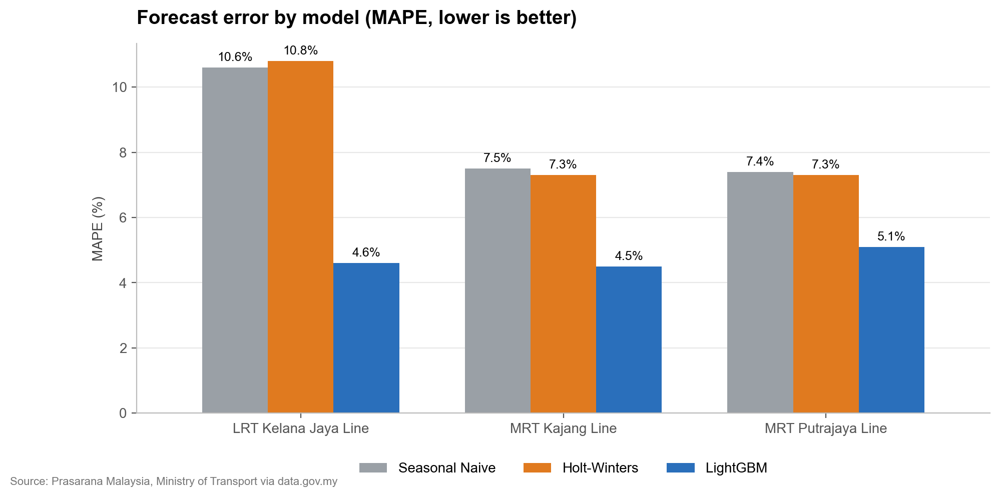
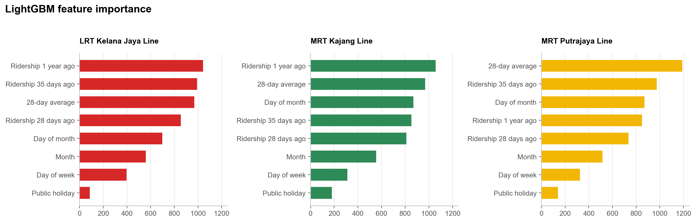

# Rapid KL Rail Ridership Forecasting

28-day daily ridership forecast for three Rapid KL rail lines using public Malaysian data.

## Overview
- Lines: LRT Kelana Jaya, MRT Kajang, MRT Putrajaya
- Compared three models: Seasonal Naive, Holt-Winters, LightGBM
- LightGBM cut forecast error by 31% to 57% vs the baseline

## Data
- Dataset: Daily Public Transport Ridership
- Source: Prasarana Malaysia, Ministry of Transport via data.gov.my
- License: CC BY 4.0
- Loaded live from the data.gov.my URL, not stored in this repo

## Dataset and Split


| Set | Period | Days | Share |
|---|---|---|---|
| Warm-up (lag history) | 2023-04-01 to 2024-03-29 | 364 | 29.1% |
| Training | 2024-03-30 to 2026-08-03 | 857 | 68.6% |
| Testing | 2026-08-04 to 2026-08-31 | 28 | 2.2% |
| Total | 2023-04-01 to 2026-08-31 | 1,249 | 100.0% |

- Time-based split, no shuffling
- Warm-up days only build the 1-year lag feature
- Test window matches the 28-day forecast horizon

## Tech Stack
| Purpose | Tool |
|---|---|
| Environment | Python, Jupyter (Anaconda) |
| Data handling | pandas, NumPy |
| Statistical model | statsmodels (Holt-Winters) |
| Machine learning | LightGBM |
| Evaluation | scikit-learn (MAE, RMSE, MAPE) |
| Holidays | holidays (Malaysia) |
| Visualisation | matplotlib |

## Method
- Seasonal Naive: repeats the last known week
- Holt-Winters: additive trend and weekly seasonality
- LightGBM features: day of week, month, day of month, Malaysian public holiday, lags (28, 35, 364 days), 28-day rolling mean
- Lags start at 28 days to avoid data leakage

## Exploratory Analysis





## Results




MAPE (lower is better):

| Line | Seasonal Naive | Holt-Winters | LightGBM |
|---|---|---|---|
| LRT Kelana Jaya | 10.6% | 10.8% | 4.6% |
| MRT Kajang | 7.5% | 7.3% | 4.5% |
| MRT Putrajaya | 7.4% | 7.3% | 5.1% |

Full MAE and RMSE are in `results.csv`.

## Key Findings
- LightGBM was best on all three lines
- Baseline and Holt-Winters missed the Merdeka holiday drop by about 100K+ trips
- Kajang is the busiest line (261K trips per day, last 12 months)
- Kajang weekends hold up better than Kelana Jaya
- Putrajaya ridership more than doubled since Apr 2023

## Limitations
- Single 28-day test window containing two holidays
- Federal holidays only, no state or school holidays
- Headline line totals, no station level data

## Next Steps
- Rolling-origin cross-validation
- School holiday and festive period flags
- Interactive Streamlit dashboard

## How to Run
```bash
pip install -r requirements.txt
jupyter notebook forecast.ipynb
```
